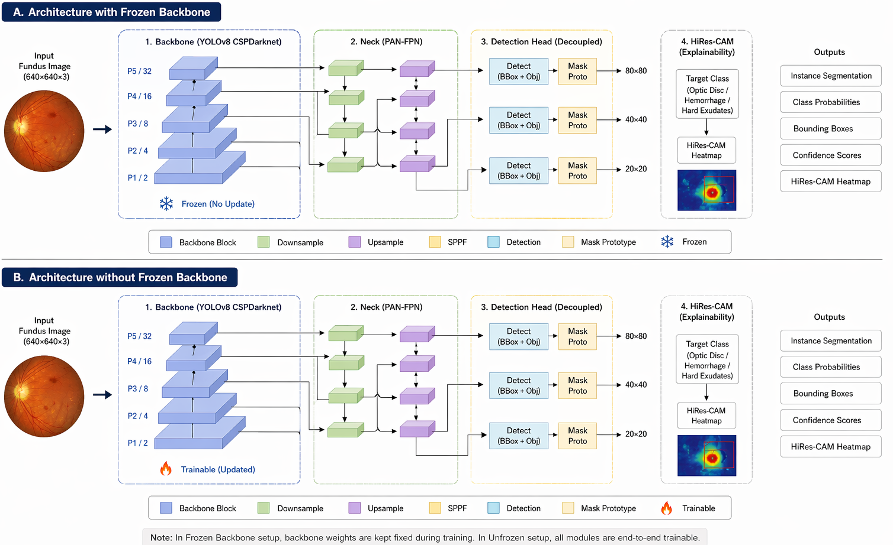
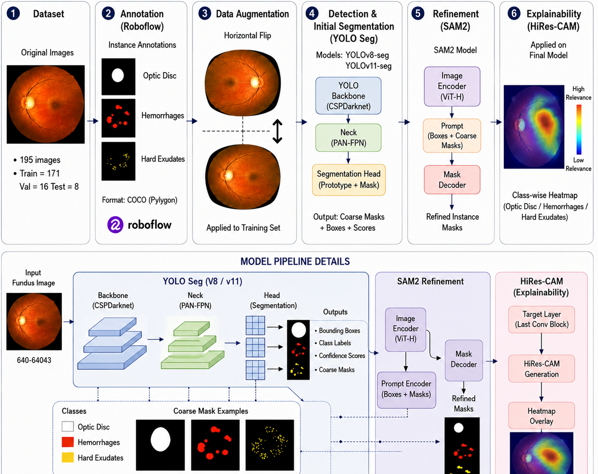
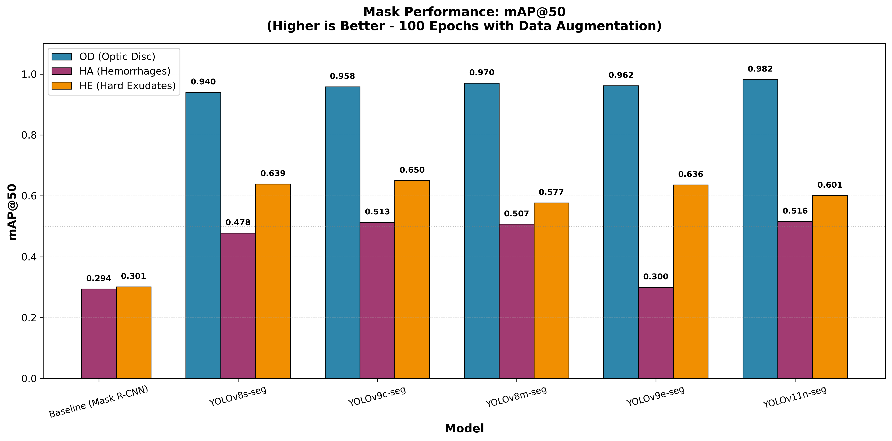

# An Explainable YOLO-SAM Framework with Ensemble Masking for Retinal Lesion Segmentation

## Data set
The full- annotated data set in instance segmentation format will be  uploaded 


## 1. Methodology

The proposed framework (Figure 1) combines the efficiency of YOLOv8/11‑seg for initial lesion proposal, the generalisation capability of SAM2 for mask refinement, and HiResCAM for generating class‑activation maps that highlight diagnostically relevant regions.

**Figure 1 – Proposed YOLO‑HiResCAM Architecture**  


## 2. Segmentation Results

A representative segmentation output is shown in Figure 2. The combination of YOLO‑seg and SAM2 produces smooth, instance‑level lesion masks directly overlaid on the fundus image.

**Figure 2 – Example Segmentation Output (AVIF format)**  


**Figure 3 – YOLO‑SAM‑XAI Integration**  


## 3. Comparative Evaluation

Quantitative and qualitative comparisons against baseline models are summarised in Figure 4. The proposed method demonstrates improved segmentation fidelity and explanatory clarity.

**Figure 4 – Performance Comparison**  


## 4. Cross Validation Result

To determine how robust and generalizable the suggested models are, the IDRiD dataset was used to perform five-fold cross-validation using the best performing YOLOv8n-seg and YOLOv11n-seg architectures. The average and standard deviations of mAP@50 for each class of retinal object across all folds is provided in the table below. Both models performed exceptionally well for optic disc (OD) segmentation, with an average mAP of more than 98%. For the segmentation of lesions, YOLOv11n-seg had the greatest mean mAP at 50 for hard exudates (HE) at 72.74%, and YOLOv8n-seg had the greatest average mAP at 50 for hemorrhages (HA) at 63.28%. Both models had low standard deviations indicating that the results are stable across different splits of data.

| Model        | Class | Mean mAP@50 | Std mAP@50 |
|-------------|-------|------------:|-----------:|
| YOLOv8n-seg | HA    | 0.6328 | 0.0345 |
|             | HE    | 0.7226 | 0.0303 |
|             | OD    | 0.9860 | 0.0089 |
| YOLOv11n-seg| HA    | 0.6046 | 0.0383 |
|             | HE    | 0.7274 | 0.0299 |
|             | OD    | 0.9876 | 0.0054 |

## 5. Live Demonstration

An interactive Space is hosted on Hugging Face, allowing real‑time testing on custom fundus images.

[](https://huggingface.co/spaces/woldemerkorios/Retina_lesion)

**Access the live demo:** [Retina Lesion Space](https://huggingface.co/spaces/woldemerkorios/Retina_lesion)

## 6. Model Availability

Trained weights for the YOLOv8‑seg variants are provided for reproducibility and further fine‑tuning.

- [yolov8n_seg_100epoch_best.pt](https://huggingface.co/spaces/woldemerkorios/Retina_lesion/blob/main/yolov8n_seg_16_batch_100epoch_best.pt)  
 
- [yolov8s_seg_100epoch_best.pt](https://huggingface.co/spaces/woldemerkorios/Retina_lesion/blob/main/yolov8s_seg_16batch_100epoch_best.pt)  
  

## 7. Quick Start

### Installation

```bash
# Clone the repository
git clone https://github.com/Addisu-Amare/Res.git
cd Res

# Install dependencies
pip install -r requirements.txt
